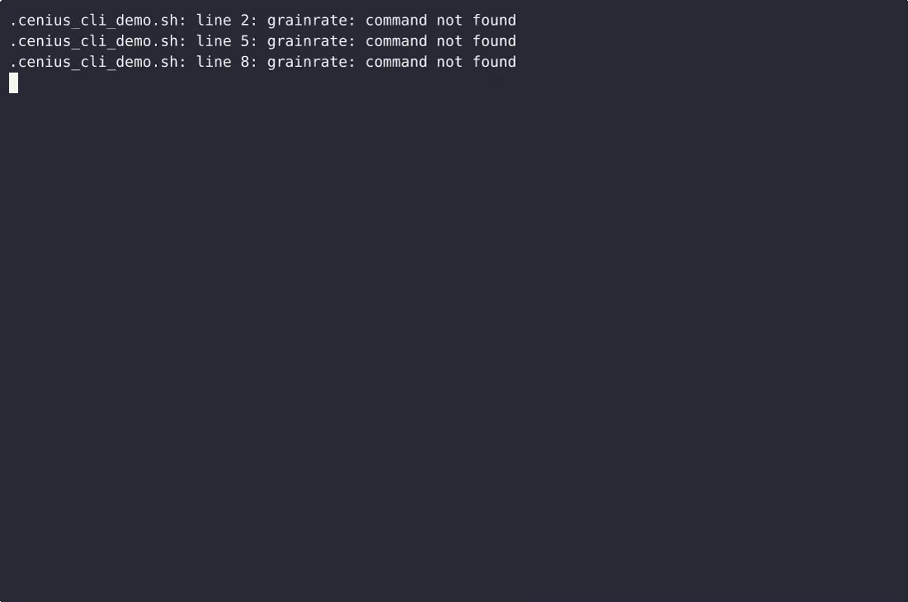

# GrainRate — complete Full-stack app command-line tool example app

**GrainRate** is a production-grade command-line tool written in Full-stack app — generated by cenius.ai, Apache-2.0-licensed. GrainRate is a single-file, standard-library Python CLI that stores bins, compares each bin's grain moisture with built-in safe storage limits, reports at-risk bins before turning, and logs daily silo temperature read…. Clone GrainRate, run the installer, done — you have a working product in minutes. Want to change something? [Open GrainRate on cenius.ai](https://cenius.ai/marketplace/p/grainrate?ref=gh&utm_campaign=grainrate-webapp) and say what you need — a revised build ships back, ready to deploy.


[](LICENSE)  [](https://cenius.ai)

[](https://cenius.ai/marketplace/p/grainrate?ref=gh&utm_campaign=grainrate-webapp)

> **▶ [Open & edit in cenius.ai](https://cenius.ai/marketplace/p/grainrate?ref=gh&utm_campaign=grainrate-webapp)** — one click to an editable workspace: describe changes in plain English, get an instant preview, one-click deploy and host. Modifications made on the platform come with full rebrand & relicense rights.

_Local clone? See [Quick start](#quick-start) below. cenius.ai is the zero-setup path._

## Demo


📽 **[Demo video on cenius.ai](https://cenius.ai/marketplace/p/grainrate?ref=gh&utm_campaign=grainrate-webapp)** — the complete run-through · [MP4](.github/media/demo.mp4)

## Screenshots



## Features

- Compare stored grain moisture to safe storage tables
- Flag bins at risk of spoilage before turning
- Log daily silo temperature readings

## Quick start

```bash
./install.sh   # installs dependencies + seeds demo data
```

See [`INSTALL.md`](INSTALL.md) for full setup and usage instructions.

## Architecture

Folder layout: `tests/`. `install.sh` provisions dependencies and seeds demo data so the app starts with something real to explore. Built in Full-stack app (22 files). Step-by-step setup guide: [`INSTALL.md`](INSTALL.md).

## Usage guide

Every example below uses `python3 grainrate.py`; after `bash install.sh` you can
write `grainrate` instead. Commands print results on **stdout**, errors on
**stderr**, and never prompt unless a passphrase is being typed at a terminal.

### 1. Register bins

```bash
python3 grainrate.py bin add --name "North 1" --grain corn --moisture 14.5
## Added bin North 1  corn  14.5% moisture  (safe limit 15.0%)

python3 grainrate.py bin add --name "South 2" --grain soybean --moisture 14.2
python3 grainrate.py bin add --name "West 3" --grain wheat --moisture 13.0
```

Rules enforced on `add` **and** `update` (identical validation code):

- `--moisture` must be a number between 0 and 100, stored to 0.1 %:
  `error: moisture must be a number between 0 and 100` (exit 1, nothing saved).
- Names are unique, case-insensitively trimmed: `error: bin name already exists: North 1`.
- `--grain` must be one of the built-in grains, named in the error:
  `error: unknown grain 'rye'; supported grains: barley, canola, corn, oats, rice, sorghum, soybean, sunflower, wheat`.

```bash
python3 grainrate.py bin list
```

```
Bins · 3
NAME     GRAIN    MOISTURE  UPDATED
───────  ───────  ────────  ──────────
North 1  corn        14.5%  2026-10-18
South 2  soybean     14.2%  2026-10-18
West 3   wheat       13.0%  2026-10-18
3 bins · /home/you/.grainrate/store.json
```

With no bins yet, `bin list` prints the next command to run:

```
No bins yet. Add one with: grainrate.py bin add --name "North 1" --grain corn --moisture 14.5
```

### 2. Update a bin as conditions change

_Full guide: [`USAGE.md`](USAGE.md)_

## FAQ

### What's the quickest way to self-host GrainRate?

Everything you need ships in this repo: clone it, run `./install.sh` to install dependencies and seed demo data, then follow [`INSTALL.md`](INSTALL.md) to start it. No external services required.

### What powers GrainRate under the hood?

Powered by Full-stack app. This repo is the real thing — full source, seed data, and all — ready to clone and start up. Highlights include compare stored grain moisture to safe storage tables.

### Can I use GrainRate in a commercial project?

Yes — it ships under the Apache-2.0 license, which permits commercial use, modification and redistribution. The full text is in [LICENSE](LICENSE).

### How do I make GrainRate my own brand?

Absolutely. [Open it on cenius.ai](https://cenius.ai/marketplace/p/grainrate?ref=gh&utm_campaign=grainrate-webapp) and remix it there — platform modifications come with full rebrand and relicense rights over your derivative, so the result is entirely yours.

### Is there a no-code way to modify GrainRate?

Yes — [load it on cenius.ai](https://cenius.ai/marketplace/p/grainrate?ref=gh&utm_campaign=grainrate-webapp), describe the change in plain English, and you get back a fresh build with your modification applied.

## License & rebranding

Released under the [Apache License 2.0](LICENSE) (© 2026 Cenius AI) — free for personal and commercial use. The Cenius name/logo are trademarks (see NOTICE).

**Need a customized version?** [Remix this app on cenius.ai](https://cenius.ai/marketplace/p/grainrate?ref=gh&utm_campaign=grainrate-webapp) — modifications made on the platform come with **full rebrand & relicense rights** over your derivative.

## Built with cenius.ai

This entire application — code, design, seeded demo data — was generated on **[cenius.ai](https://cenius.ai)** from a plain-English description.

- 🚀 [Build your own app on cenius.ai](https://cenius.ai)
- 🎛️ [Remix GrainRate on the marketplace](https://cenius.ai/marketplace/p/grainrate?ref=gh&utm_campaign=grainrate-webapp) — open it in a workspace, prompt for changes, and ship your own version.

More open-source apps: [the Cenius-ai catalog](https://github.com/Cenius-ai) · [showcase index](https://github.com/Cenius-ai/showcase)
